<div align="center">

# 🧟 BOZ Reimagined

**Call of Duty: Black Ops Zombies (2012), rebuilt for big screens and controllers.**<br>
Play on **PC (Linux & Windows)** or **Android TV**, together in co-op, from your own copy of the game.

[](https://github.com/chgmcontato/boz-reimagined/releases/latest)
[](#-quick-start)
[](https://github.com/chgmcontato/boz-reimagined)
[](https://github.com/chgmcontato/boz-reimagined/commits/main)
[](LICENSE)

<br>

<!-- Substitua este texto pelo link do vídeo/GIF de apresentação:  -->
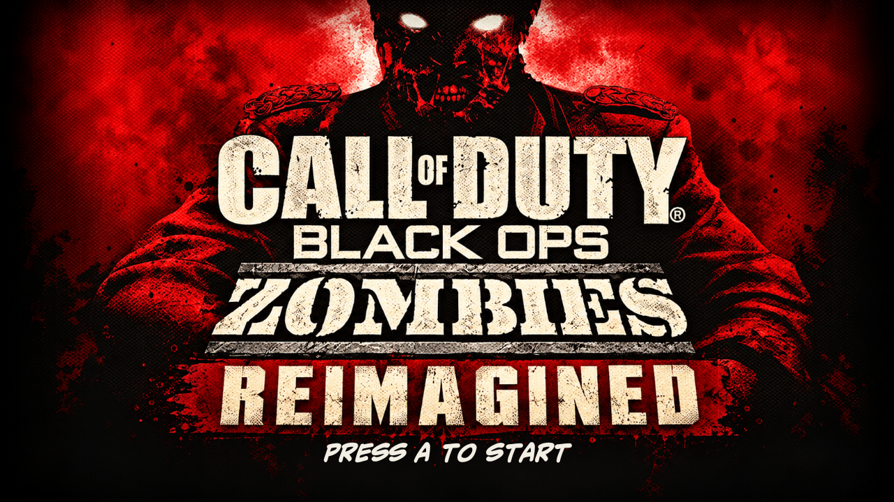

<sub>No game data is included. You need your own APK + OBB (Android 1.0.11) or IPA (iOS 1.3.5).</sub>

</div>

---

## ✨ Features

| | |
|---|---|
| 🖥️ **PC port** | Runs the original ARM game code on the **Dynarmic JIT**: 60 fps with vsync, 200+ fps without |
| 📺 **Android TV** | Patched APK played entirely with a gamepad, no touch HUD |
| 🤝 **Cross-platform co-op** | PC and TV join the same Local Wi-Fi lobby (works over ZeroTier too) |
| 🎮 **Console controls** | Xbox-style layout inspired by Black Ops on consoles, fully remappable on PC |
| 🎨 **Reimagined menus** | Comic-style redesign of every screen, pause menu with match data, match timer |
| ⏸️ **Smart co-op pause** | The match freezes when a player drops and resumes when they're back |
| 🍎 **iOS mode (PC)** | Installs the 1.3.5 IPA directly, with its PVRTC textures decoded on the fly |
| 📦 **Your copy, your files** | Installs from your own APK/IPA; the OBB is read in place and never copied |

---

## 📸 Screenshots

### PC

| Launcher | Main menu |
| :---: | :---: |
| 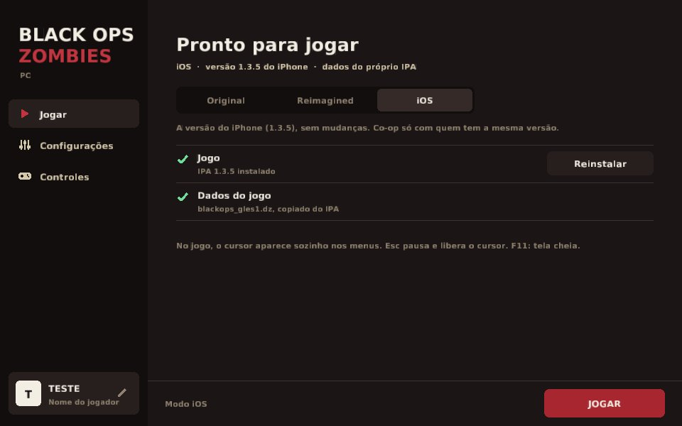 | 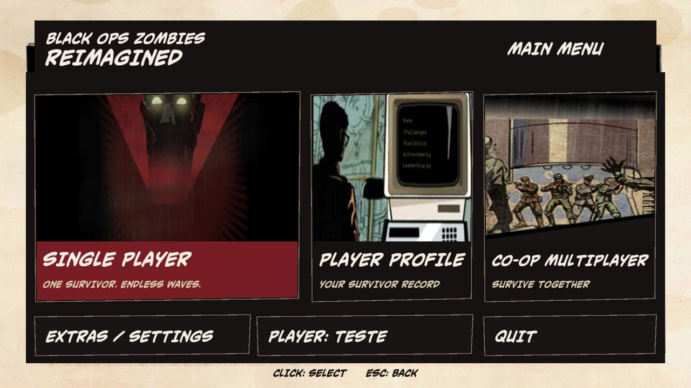 |
| **Character & map select** | **Gameplay · Call of the Dead** |
| 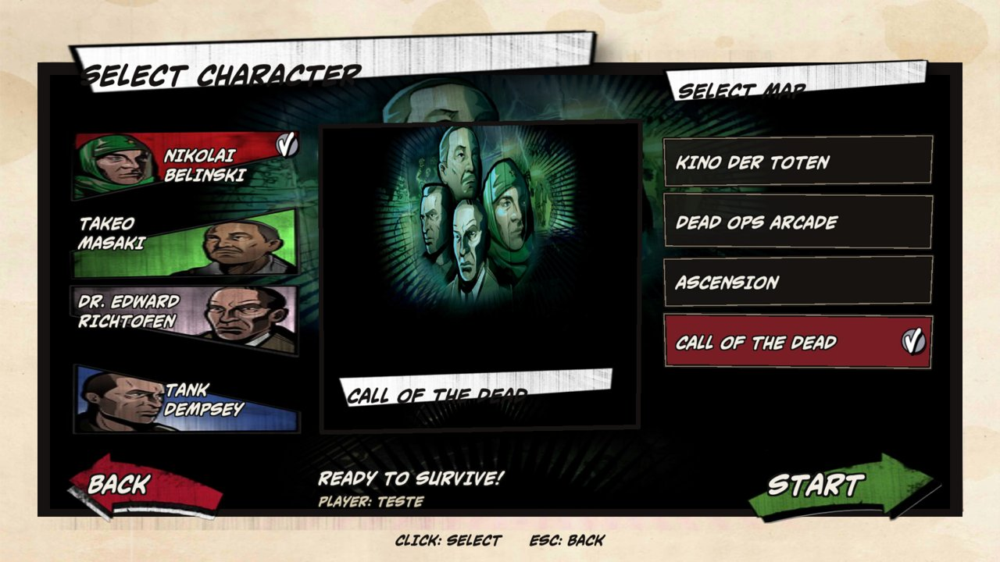 | 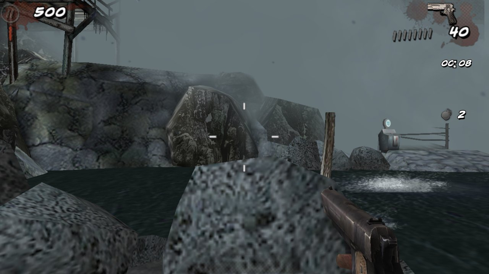 |
| **Co-op lobby (PC + TV)** | **Co-op pause card** |
| 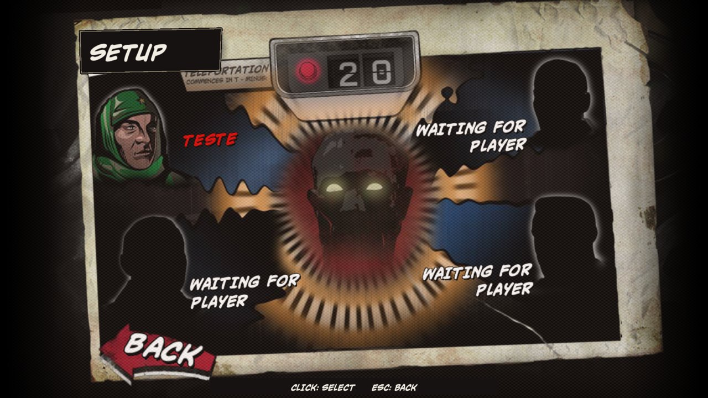 | 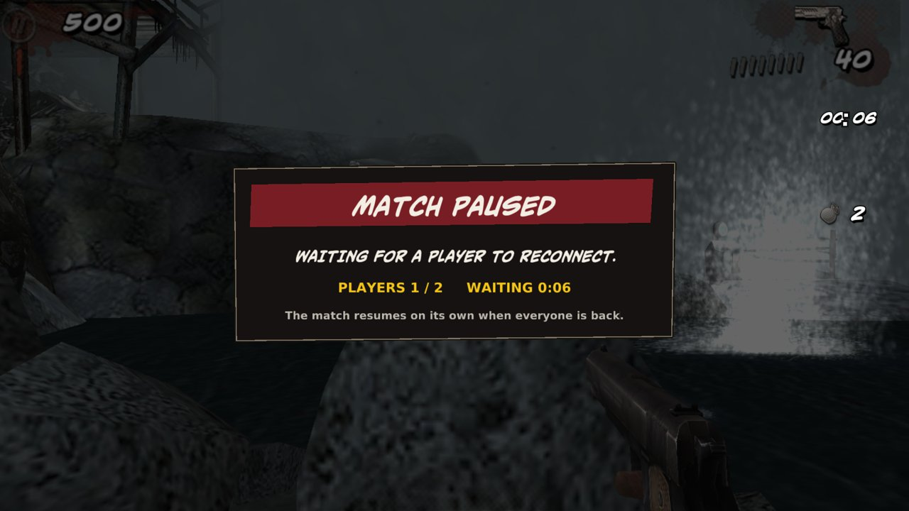 |

### Android TV

| Pause · Kino der Toten | Pause · Call of the Dead |
| :---: | :---: |
| 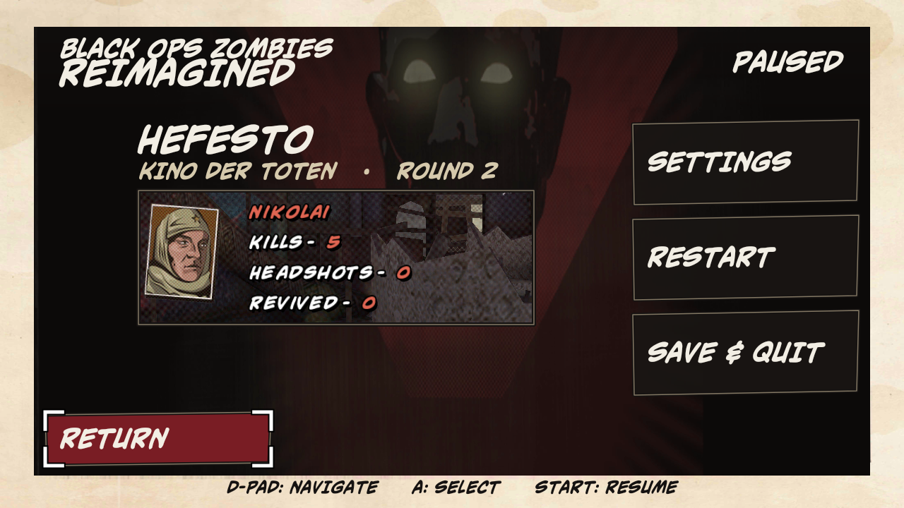 | 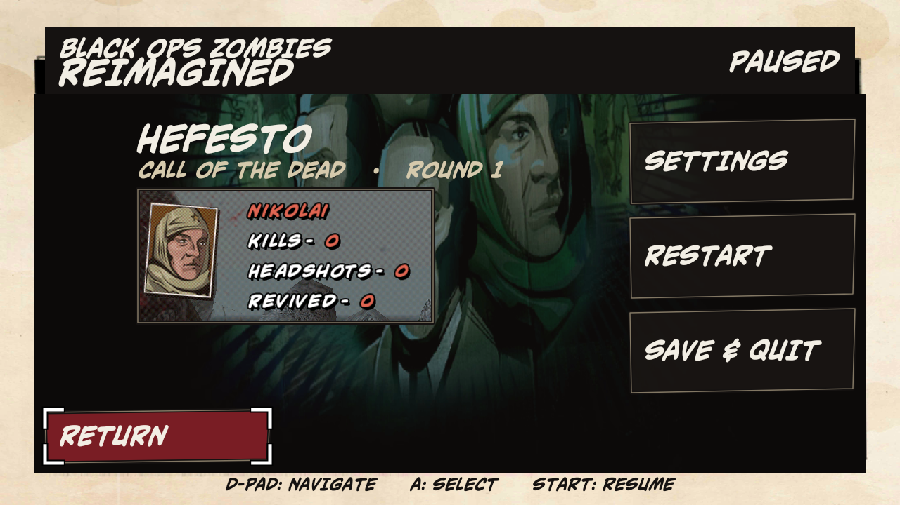 |
| **Dead Ops Arcade HUD** | **Player Profile** |
| 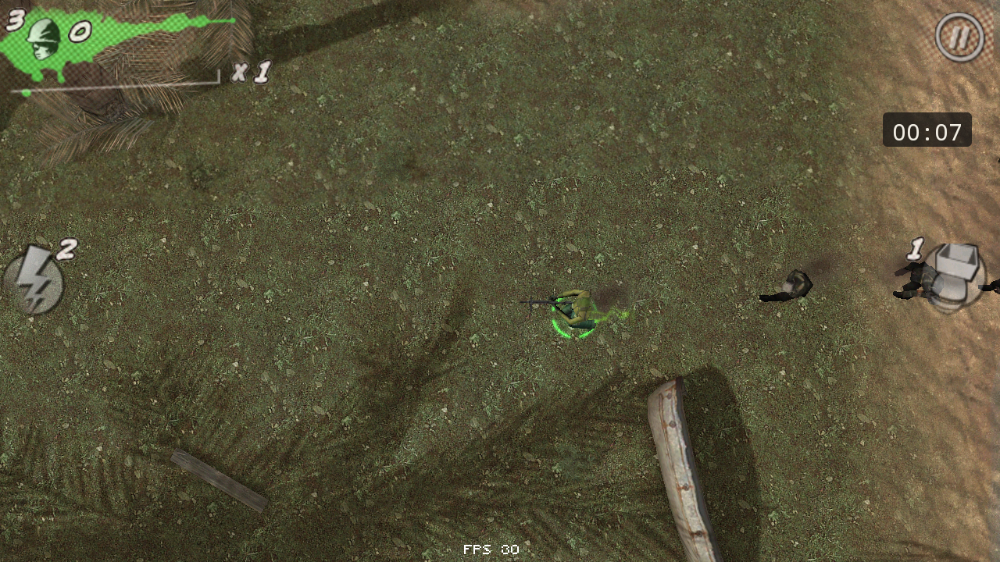 | 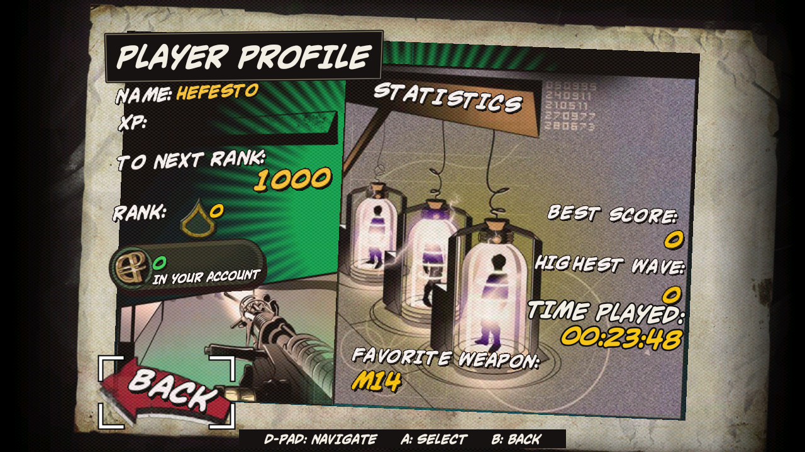 |

<details>
<summary><b>iOS mode</b></summary>
<br>

| iOS 1.3.5 main menu, on PC |
| :---: |
| 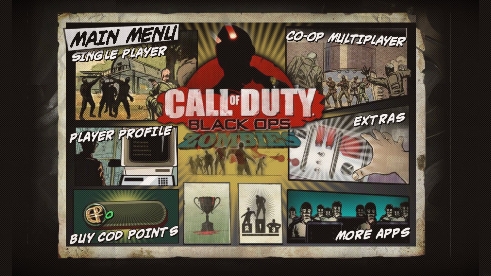 |

</details>

---

## 🛠️ Tech Stack

<div align="center">


</div>

| Layer | What it does |
|---|---|
| **PC** (`src/`) | Reimplements the Marmalade s3e runtime (EGL, OpenGL ES, audio, sockets, ZeroConf) on SDL2 + desktop OpenGL; the game's ARM code runs on Dynarmic |
| **TV** (`tv/`) | Byte-verified binary patches over the original APK, plus a Java layer for gamepad, menus, HUD and pause |
| **Tooling** | Python patchers, Frida scripts and Ghidra notes used for the reverse engineering |

---

## 🚀 Quick Start

> **Requirement:** your own copy of the game. Android **1.0.11** APK + `blackops_etc.dz` OBB, or (PC only) the iOS **1.3.5** IPA. Hashes are in [`tv/README.md`](tv/README.md).

### 🖥️ PC: prebuilt

1. Download from [**Releases**](https://github.com/chgmcontato/boz-reimagined/releases/latest):
   - **Windows 10/11:** `codboz-pc-windows-x64.zip` (one `.exe`, no extra DLLs)
   - **Linux:** `codboz-pc-linux-x86_64.tar.gz` (needs SDL2 and glibc 2.39+)
2. Run it. In the launcher: **Install** → your APK or IPA → **Select OBB** → **PLAY**.

```bash
# Linux
sudo apt install libsdl2-2.0-0
tar xzf codboz-pc-linux-x86_64.tar.gz && ./codboz-pc/codboz-pc
```

Data and saves live in `game/`, next to the executable.

### 🖥️ PC: build from source

```bash
git clone --recursive https://github.com/chgmcontato/boz-reimagined.git
cd boz-reimagined

# Linux (needs SDL2 dev files, CMake and Boost headers)
make CC=gcc CXX=g++ BOOST_INCLUDE_DIR=/path/to/boost/include
./run.sh

# Windows .exe, cross-built from Linux with MinGW-w64
make win-deps
make PLATFORM=windows win-dist      # → build-win/codboz-pc-windows.zip
```

### 📺 Android TV

```bash
# needs adb and xdelta3; TV with ADB over network enabled
bash tv/instalar.sh <TV-IP> base.apk blackops_etc.dz boz-reimagined-tv-v0.2.xdelta
```

The patch only works on top of the original APK. Full guide, including co-op over ZeroTier, in [`tv/README.md`](tv/README.md) · [português](tv/README.pt-BR.md).

---

## 📚 Technical notes (PC)

<details>
<summary><b>Game modes: Original, Reimagined, iOS</b></summary>
<br>

| | Original | Reimagined | iOS |
|---|---|---|---|
| Install from | Android APK 1.0.11 | Reimagined TV APK | iOS IPA 1.3.5 |
| `boz.s3e` | untouched | the TV's own, byte for byte | decoded from the IPA |
| Co-op with | phones running the original | TVs and PCs running Reimagined | the same iOS version |
| Waves / drops | mobile rules | BO1 horde pace, BO1 drop cycle, Death Machine/DG-2 rules | mobile rules |
| HUD | mobile HUD without touch buttons | TV HUD: grenade counters, match timer, FPS counter | mobile HUD |

Co-op needs the **same mode on both sides**: Reimagined changes game rules that host and client
both simulate. The PC adds nothing to the network protocol. On iOS, the installer takes the game
image out of the armv7 executable and decodes its scrambled data part (the key comes from the
image's own relocations).

</details>

<details>
<summary><b>Controls</b></summary>
<br>

Remap everything in the launcher (**Controles**) or in `bindings.txt`. Defaults:

| Action | Keyboard / mouse | Controller (BO1 layout) |
|---|---|---|
| Move / look | WASD / mouse | sticks |
| Shoot / aim (hold) | left / right button | RT / LT |
| Use, buy, sprint | E, Shift, Space | A |
| Reload | R | X |
| Switch weapon | 1, wheel | Y |
| Crouch | C, Ctrl | B |
| Melee | V, middle button | RS |
| Grenade / tactical / claymore | G / Q / 4 | RB / LB / D-pad right |
| Pause | Esc | Start |

The mouse is a cursor on every recognised menu and a camera in gameplay; the switch is automatic.
On the pause screen, T toggles the match timer. F11: fullscreen. F3: FPS counter.

</details>

<details>
<summary><b>CPU emulation, Windows build, debugging</b></summary>
<br>

- The game's ARM code runs on the Dynarmic A32 JIT (`third_party/dynarmic`). Call of the Dead
  without vsync runs at about 211 fps on a Radeon 610M laptop. The earlier Unicorn backend lives
  at tag `last-unicorn`; details in `tools/dynarmic_probe/README.md`.
- `CODBOZ_DYN_FASTMEM=1` is faster still but lets the game reach any low host memory;
  `CODBOZ_DYN_CODE_WATCH=1` checks for self-modifying code (none found).
- Windows is cross-built with MinGW-w64 (`brew install mingw-w64`). There the guest heap is 764 MB
  instead of 1 GB (Windows keeps a page at 0x7ffe0000); a match uses about 155 MB.
- `CODBOZ_PERF=1` logs a per-second performance line; `CODBOZ_SCRIPT` drives the game from a
  script (used for the screenshots above); `CODBOZ_PREVIEW_COOP_PAUSE=1` shows the co-op pause card.

</details>

<details>
<summary><b>Known issues</b></summary>
<br>

- Windows: tested under Wine (menus, a Call of the Dead match, 60 fps); not yet on real Windows, co-op untested there.
- Save & Quit → Continue does not restore the match timer.
- iOS mode: the first click after the title screen is ignored (click again); `s3eInetPton` is still a stub.

</details>

<details>
<summary><b>Repository layout</b></summary>
<br>

| Path | Contents |
|---|---|
| `src/`, `Makefile`, `run.sh` | PC port. `make` builds `build/codboz-pc`; `make clean` keeps `build/game` (installed data and saves) |
| `tv/` | Android TV project: patchers, Java layer (`tv/java`), installer, map tools, docs |
| `third_party/` | Dynarmic (submodule), cJSON, LZMA SDK, dr_mp3, stb (each under its own license) |
| `tools/` | tests, the Dynarmic probe, code generators |
| `docs/screenshots/` | images used in this README |

</details>

---

## 🤝 Contributing

Bug reports and ideas are welcome:

- 🐛 **Found a bug?** [Open an issue](https://github.com/chgmcontato/boz-reimagined/issues) with the **platform**, **map**, **round** and a **screenshot**.
- 🔧 **Want to code?** Fork, branch from `main`, and open a pull request with a short description and how you tested it.
- ⚠️ Never commit game files (APK, OBB, IPA, `.s3e`, extracted assets).

---

## 📄 License

Code released under the [MIT License](LICENSE).

<sub>BOZ Reimagined is a fan project, not affiliated with or endorsed by Activision or Treyarch. *Call of Duty* and *Black Ops* are trademarks of Activision Publishing, Inc. This repository contains no game code or assets.</sub>
