<div align="center">

# 🧟 BOZ Reimagined

**Call of Duty: Black Ops Zombies (2012), refeito para telas grandes e controle.**<br>
Jogue no **PC (Linux e Windows)**, na **Android TV** ou em **celulares Android**, juntos no co-op, a partir da sua própria cópia do jogo.

[](https://github.com/chgmcontato/BOZ-Reimagined/releases/latest)
[](#-guia-rápido)
[](https://github.com/chgmcontato/BOZ-Reimagined)
[](https://github.com/chgmcontato/BOZ-Reimagined/commits/main)
[](LICENSE)

[English](README.md) · **Português**

<br>

<!-- Substitua este texto pelo link do vídeo/GIF de apresentação:  -->
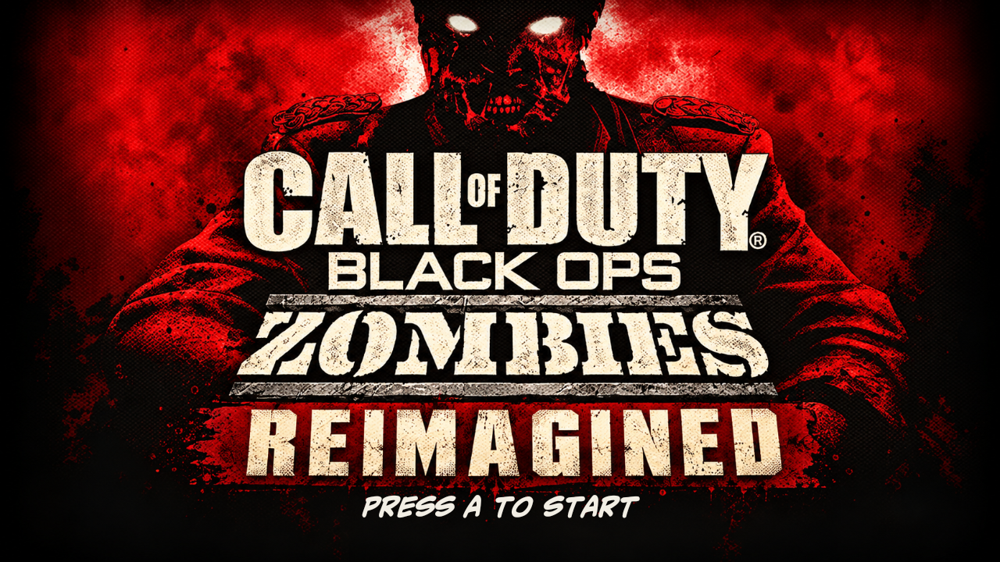

<sub>Nenhum dado do jogo vem aqui. Você precisa do seu APK + OBB (Android 1.0.11) ou do seu IPA (iOS 1.3.5).</sub>

</div>

---

## ✨ Recursos

| | |
|---|---|
| 🖥️ **Port para PC** | Roda o código ARM original do jogo no **JIT Dynarmic**: 60 fps com vsync, mais de 200 sem |
| 📺 **Android TV** | APK modificado, jogado inteiro no controle, sem HUD de toque |
| 📱 **Celulares Android** | O runtime do PC em celulares ARM64, com controles de toque |
| 🤝 **Co-op entre plataformas** | PC, TV e celular entram no mesmo lobby Local Wi-Fi ([como funciona](#-como-funciona-o-co-op)) |
| 🎮 **Controles de console** | Layout no padrão Xbox, inspirado no Black Ops dos consoles, totalmente remapeável no PC |
| 🎨 **Menus Reimagined** | Todas as telas redesenhadas em estilo quadrinhos, pause com dados da partida, timer |
| 🏆 **Placar** | Segure Tab ou Select para ver um placar no estilo do Black Ops, com estatísticas ao vivo de todos no co-op |
| ⏸️ **Pausa inteligente no co-op** | A partida congela quando um jogador cai e volta quando ele retorna |
| 🍎 **Modo iOS (PC)** | Instala direto o IPA 1.3.5, com as texturas PVRTC decodificadas na hora |
| 📦 **Sua cópia, seus arquivos** | Instala a partir do seu APK/IPA; o OBB é lido no lugar e nunca copiado |

---

## 📸 Screenshots

### PC

| Launcher | Menu principal |
| :---: | :---: |
| 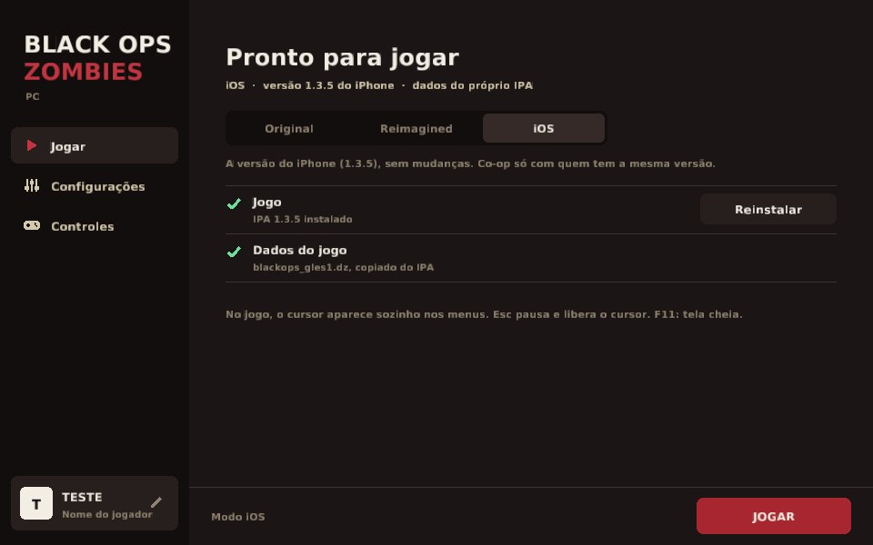 | 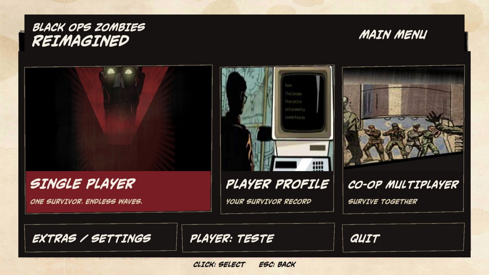 |
| **Seleção de personagem e mapa** | **Gameplay · Call of the Dead** |
| 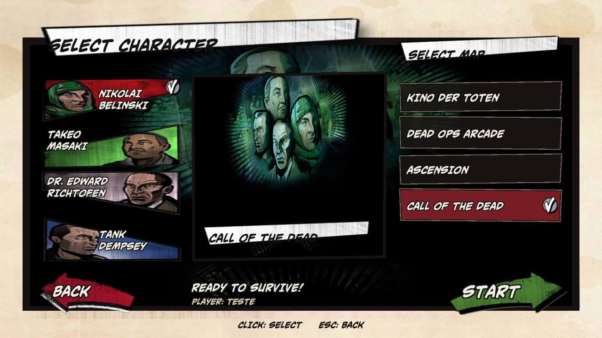 | 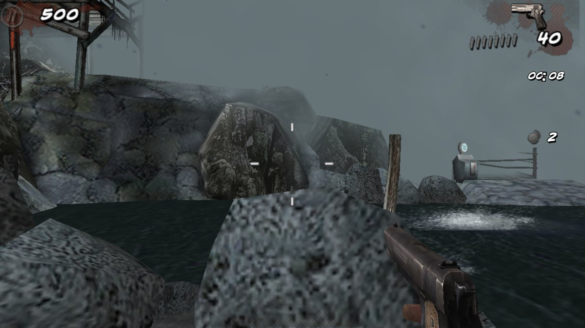 |
| **Lobby co-op (PC + TV)** | **Cartão de pausa no co-op** |
| 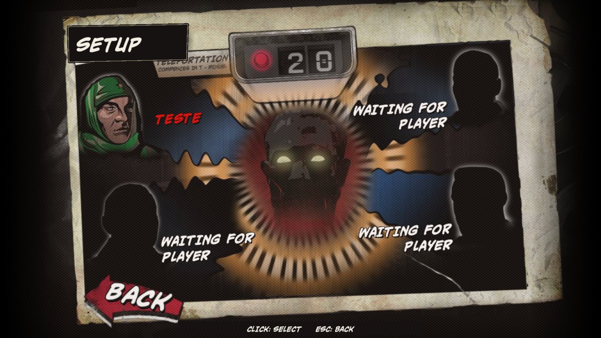 | 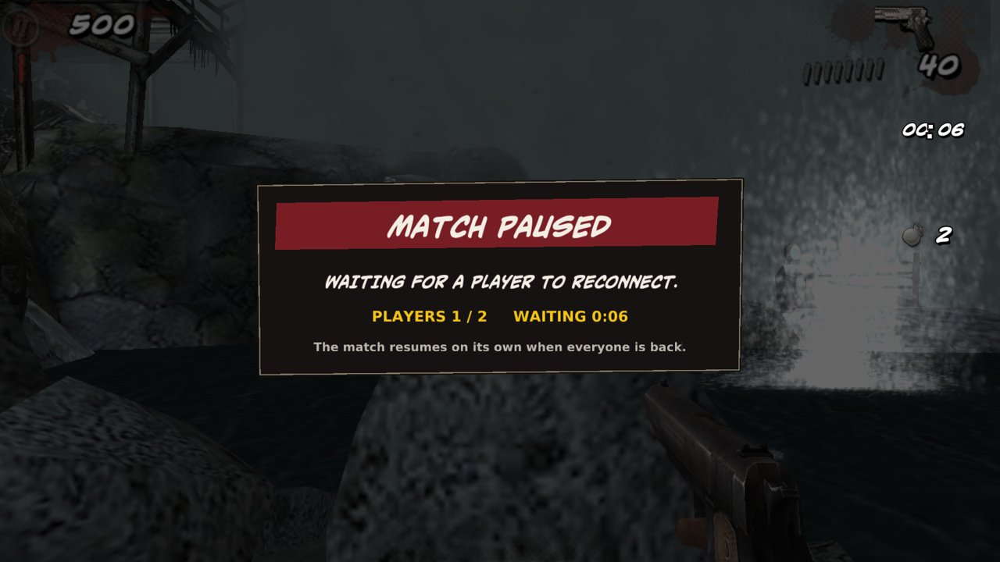 |

### Android TV

| Pause · Kino der Toten | Pause · Call of the Dead |
| :---: | :---: |
| 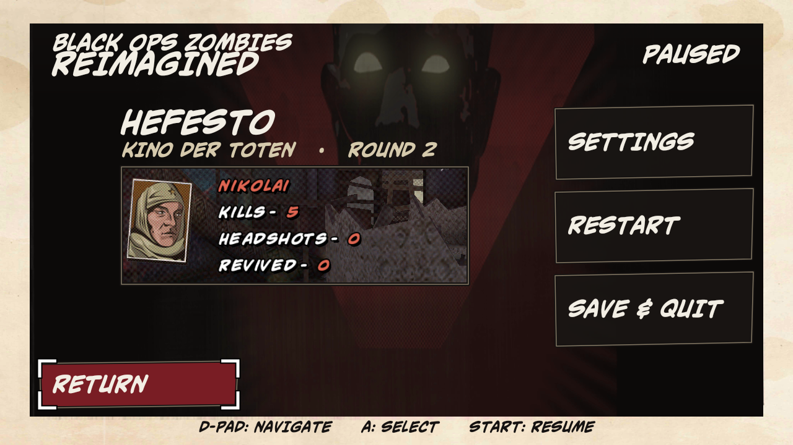 | 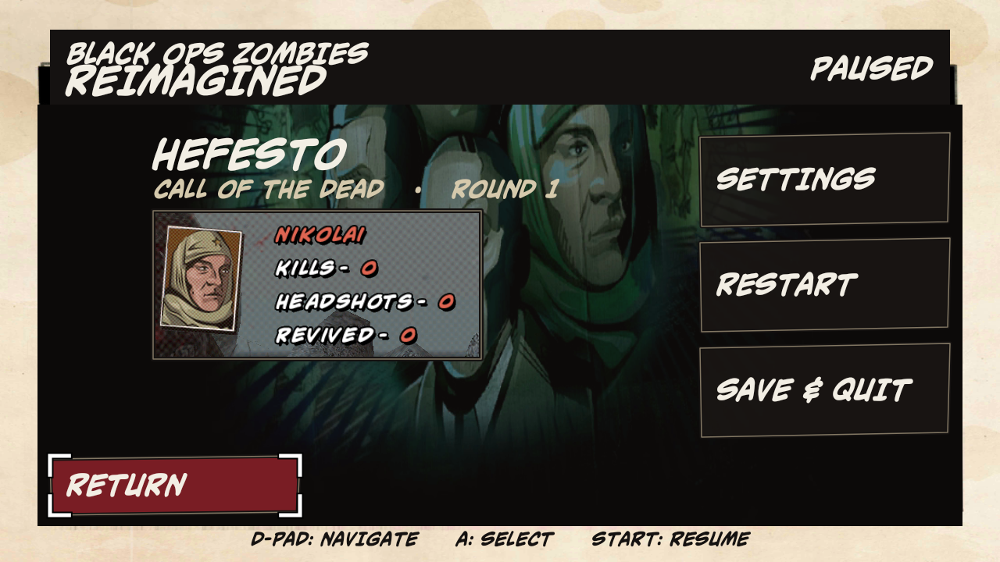 |
| **HUD do Dead Ops Arcade** | **Player Profile** |
| 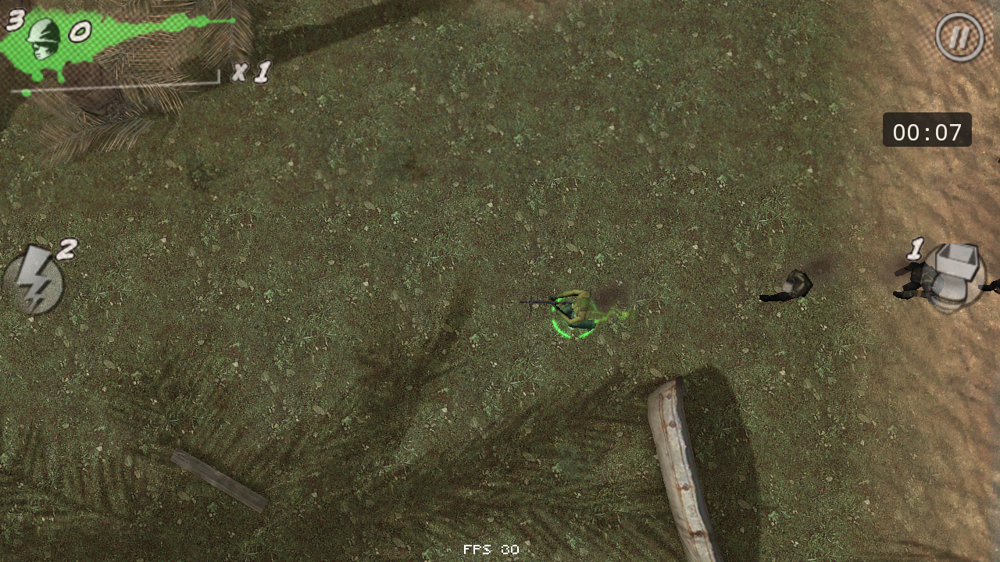 | 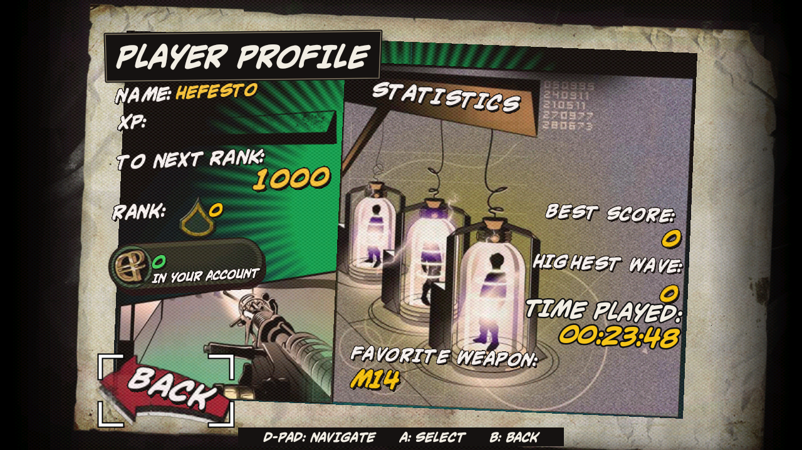 |

<details>
<summary><b>Modo iOS</b></summary>
<br>

| Menu principal do iOS 1.3.5, no PC |
| :---: |
| 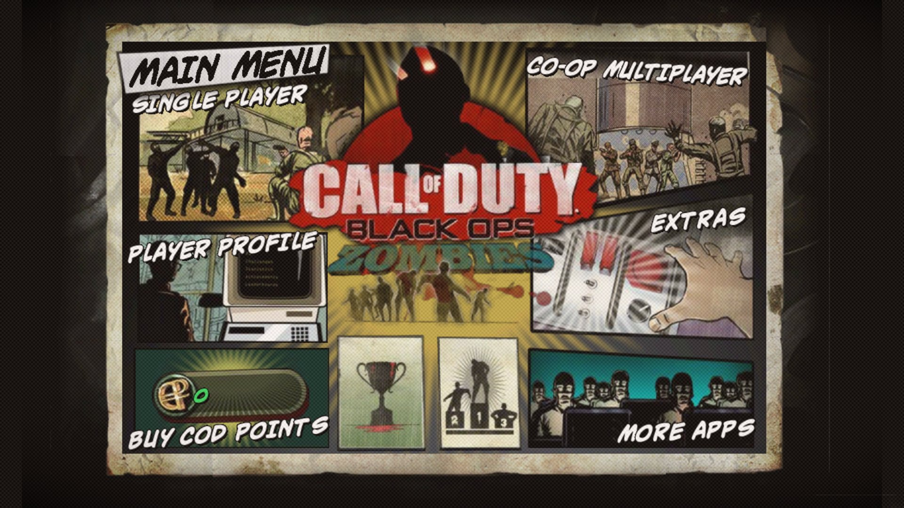 |

</details>

---

## 🛠️ Tecnologias

<div align="center">


</div>

| Camada | O que faz |
|---|---|
| **PC** (`src/`) | Reimplementa o runtime s3e do Marmalade (EGL, OpenGL ES, áudio, sockets, ZeroConf) em SDL2 + OpenGL de desktop; o código ARM do jogo roda no Dynarmic |
| **TV** (`tv/`) | Patches binários conferidos byte a byte sobre o APK original, mais uma camada Java para controle, menus, HUD e pause |
| **Ferramentas** | Patchers em Python, scripts Frida e notas do Ghidra usados na engenharia reversa |

---

## 🚀 Guia rápido

> **Requisito:** sua própria cópia do jogo. APK Android **1.0.11** + OBB `blackops_etc.dz`, ou (só no PC) o IPA iOS **1.3.5**. Os hashes estão em [`tv/README.pt-BR.md`](tv/README.pt-BR.md).

### 🖥️ PC: versão pronta

1. Baixe em [**Releases**](https://github.com/chgmcontato/BOZ-Reimagined/releases/latest):
   - **Windows 10/11:** `codboz-pc-windows-x64.zip` (um `.exe`, sem DLLs extras)
   - **Linux:** `codboz-pc-linux-x86_64.tar.gz` (precisa do SDL2 e da glibc 2.38+)
2. Abra. No launcher, abra a aba **Versões**: **Instalar** no cartão da versão (APK ou IPA) → **Selecionar** (OBB) → **JOGAR**. O launcher abre em inglês; troque para português em **Settings**.

```bash
# Linux
sudo apt install libsdl2-2.0-0
tar xzf codboz-pc-linux-x86_64.tar.gz && ./codboz-pc/codboz-pc
```

Dados e saves ficam na pasta `game/`, ao lado do executável.

**Atualizações:** a partir da versão seguinte à v0.5.1, o launcher se atualiza sozinho. Quando sai uma release nova, ele baixa, confere com o `SHA256SUMS.txt` da release, troca o executável e reinicia; a pasta `game/` (dados, saves, configurações) não é tocada. Para desligar: **Configurações → Atualizar automaticamente**. No Linux ele usa o comando `curl`. A v0.5.1 e as anteriores não têm o atualizador, então a próxima versão precisa ser baixada à mão uma vez.

### 🖥️ PC: compilar o código

```bash
git clone --recursive https://github.com/chgmcontato/BOZ-Reimagined.git
cd boz-reimagined

# Linux (precisa do SDL2 para desenvolvimento, CMake e headers do Boost)
make CC=gcc CXX=g++ BOOST_INCLUDE_DIR=/caminho/do/boost/include
./run.sh

# .exe de Windows, compilado a partir do Linux com MinGW-w64
make win-deps
make PLATFORM=windows all

# Pacotes de release. VERSION é a tag sem o "v"; só builds com VERSION se atualizam
# sozinhos (um `make` simples é uma versão "dev" e nunca se substitui).
make VERSION=0.5.2 linux-dist                   # → build/codboz-pc-linux-x86_64.tar.gz
make PLATFORM=windows VERSION=0.5.2 win-dist    # → build-win/codboz-pc-windows-x64.zip
```

Publique os dois pacotes na release `v<VERSION>` junto com o `SHA256SUMS.txt` (`sha256sum *.zip *.tar.gz *.xdelta > SHA256SUMS.txt`). O atualizador (`src/updater.c`) procura exatamente esses três nomes de arquivo.

### 📺 Android TV

```bash
# precisa de adb e xdelta3; TV com ADB pela rede ativado
bash tv/instalar.sh <IP-da-TV> base.apk blackops_etc.dz boz-reimagined-tv-v0.6.xdelta
```

O patch só funciona sobre o APK original. Guia completo, incluindo co-op pelo ZeroTier, em [`tv/README.pt-BR.md`](tv/README.pt-BR.md).

### 📱 Celular Android

Para celulares ARM64 com Android 8 ou mais novo. Ela não contém o jogo: você importa os seus arquivos.

1. Gere o `BOZ-TV.apk` (veja abaixo) e copie-o para o celular junto com o `blackops_etc.dz` original.
2. Instale o `boz-reimagined-mobile-v0.7.0.apk` de [**Releases**](https://github.com/chgmcontato/BOZ-Reimagined/releases/latest).
3. Abra o **BOZ Reimagined**, escolha os dois arquivos e toque em **PLAY**.

Ele instala ao lado do jogo original e da versão de TV. Desinstalar apaga os arquivos importados e os saves. Detalhes em [`mobile/README.md`](mobile/README.md).

### 🧩 Como gerar o `BOZ-TV.apk`

O `BOZ-TV.apk` contém o código do jogo, por isso não está disponível para download. Você o gera a partir do seu APK 1.0.11 com o patch, que não contém arquivos do jogo. O modo Reimagined do PC e o celular usam esse mesmo arquivo.

1. Baixe o `boz-reimagined-tv-v0.6.xdelta` de [**Releases**](https://github.com/chgmcontato/BOZ-Reimagined/releases/latest).
2. Coloque-o numa pasta com o seu APK original, com o nome `base.apk`, e confira o APK (SHA-256 `348c3ca53291b28380eca44f25198cc64e2e8ce9d56ed4ac170310aff3a86747`):

```bash
sha256sum base.apk
xdelta3 -d -s base.apk boz-reimagined-tv-v0.6.xdelta BOZ-TV.apk
```

No Windows, você também pode usar o [Delta Patcher](https://github.com/marco-calautti/DeltaPatcher). Outras versões do APK não funcionam.

---

## 🤝 Como funciona o co-op

Até 4 jogadores dividem uma partida pelo **Local Wi-Fi**. PC, Android TV e celular Android jogam juntos, em qualquer combinação.

1. **Conecte todos os aparelhos à mesma rede.** Redes de convidados e roteadores que isolam os aparelhos podem impedir que eles se encontrem.
2. **Use o mesmo modo em todos.** No PC, selecione o **Reimagined**: os modos Original e iOS não entram numa partida Reimagined.
3. **Host:** abra **Co-op → Local Wi-Fi** e crie a partida. **Os demais:** abram a mesma tela e entrem nela.

Durante a partida:

- **Os zumbis acompanham o grupo:** o tamanho do round segue o número de jogadores.
- **Se um jogador cair,** a partida congela no **Match Paused**, mostra quantos restam (`PLAYERS 1 / 2`) e volta sozinha quando ele retornar.
- **Se o host cair,** outro jogador assume e a partida continua.
- **Para voltar,** use o **RE-JOIN** no menu Co-op. Você assiste como espectador até o próximo round, como no jogo original.

Testado à mão com um PC (Linux), uma Android TV e um celular Android na mesma partida. O co-op no Windows e pelo ZeroTier ainda não foi testado.

---

## 📚 Notas técnicas (PC)

<details>
<summary><b>Modos de jogo: Original, Reimagined, iOS</b></summary>
<br>

| | Original | Reimagined | iOS |
|---|---|---|---|
| Instala a partir de | APK Android 1.0.11 | APK Reimagined da TV | IPA iOS 1.3.5 |
| `boz.s3e` | intocado | o mesmo da TV, byte a byte | decodificado do IPA |
| Co-op com | celulares com o original | TVs e PCs com o Reimagined | a mesma versão do iOS; entra em lobby de celular com o port 64 bits do iOS |
| Ondas / drops | regras do celular | ritmo de horda do BO1, ciclo de drops do BO1, regras de Death Machine/DG-2 | regras do celular |
| HUD | HUD do celular sem botões de toque | HUD da TV: contadores de granada, timer, contador de FPS | HUD do celular |

O co-op exige o **mesmo modo nos dois lados**: o Reimagined muda regras que host e cliente simulam
juntos. O PC não acrescenta nada ao protocolo de rede. No iOS, o instalador tira a imagem do jogo
do executável armv7 e decodifica a parte de dados embaralhada (a chave sai das próprias
relocações da imagem).

</details>

<details>
<summary><b>Controles</b></summary>
<br>

Remapeie tudo no launcher (**Controls**) ou no `bindings.txt`. Padrão:

| Ação | Teclado / mouse | Controle (layout do BO1) |
|---|---|---|
| Andar / olhar | WASD / mouse | analógicos |
| Atirar / mirar (segurar) | botão esquerdo / direito | RT / LT |
| Usar, comprar, correr | E, Shift, Espaço | A |
| Recarregar | R | X |
| Trocar de arma | 1, roda | Y |
| Agachar | C, Ctrl | B |
| Faca | V, botão do meio | RS |
| Granada / tática / claymore | G / Q / 4 | RB / LB / direcional para a direita |
| Pause | Esc | Start |
| Placar (segurar, só no Reimagined) | Tab | Select |

O mouse vira cursor em todo menu reconhecido e câmera no gameplay; a troca é automática. Na tela
de pause, T liga e desliga o timer. F11: tela cheia. F3: contador de FPS.

</details>

<details>
<summary><b>Emulação da CPU, versão de Windows, depuração</b></summary>
<br>

- O código ARM do jogo roda no JIT Dynarmic A32 (`third_party/dynarmic`). Call of the Dead sem
  vsync roda a cerca de 211 fps num notebook com Radeon 610M. O backend Unicorn anterior está na
  tag `last-unicorn`; detalhes em `tools/dynarmic_probe/README.md`.
- `CODBOZ_DYN_FASTMEM=1` é ainda mais rápido, mas deixa o jogo alcançar qualquer memória baixa do
  host; `CODBOZ_DYN_CODE_WATCH=1` verifica código auto-modificável (nenhum encontrado).
- O Windows é compilado com MinGW-w64 (`brew install mingw-w64`). Lá o heap do jogo tem 764 MB em
  vez de 1 GB (o Windows reserva uma página em 0x7ffe0000); uma partida usa cerca de 155 MB.
- `CODBOZ_PERF=1` registra uma linha de desempenho por segundo; `CODBOZ_SCRIPT` controla o jogo por
  script (usado nos prints acima); `CODBOZ_PREVIEW_COOP_PAUSE=1` mostra o cartão de pausa do co-op.

</details>

<details>
<summary><b>Problemas conhecidos</b></summary>
<br>

- Co-op RE-JOIN: quem volta assiste como espectador até o próximo round, como no jogo; sem o host, o YES abre um lobby próprio.
- Windows: testado no Wine (menus, uma partida de Call of the Dead, 60 fps); ainda não em Windows de verdade, co-op não testado lá.
- Save & Quit → Continue não restaura o timer da partida.
- Modo iOS: o primeiro clique depois da tela de título é ignorado (clique de novo); `s3eInetPton` ainda é um stub.

</details>

<details>
<summary><b>Estrutura do repositório</b></summary>
<br>

| Caminho | Conteúdo |
|---|---|
| `src/`, `Makefile`, `run.sh` | Port para PC. `make` gera `build/codboz-pc`; `make clean` preserva `build/game` (dados instalados e saves) |
| `mobile/` | Projeto para celulares Android; compartilha o runtime do PC em `src/` |
| `tv/` | Projeto da Android TV: patchers, camada Java (`tv/java`), instalador, ferramentas de mapas, docs |
| `third_party/` | Dynarmic (submódulo), cJSON, LZMA SDK, dr_mp3, stb (licenças em [`THIRD-PARTY.md`](THIRD-PARTY.md)) |
| `tools/` | testes, o probe do Dynarmic, geradores de código |
| `docs/screenshots/` | imagens usadas neste README |

</details>

---

## 🤝 Como contribuir

Relatos de bugs e ideias são bem-vindos:

- 🐛 **Achou um bug?** [Abra uma issue](https://github.com/chgmcontato/BOZ-Reimagined/issues) com a **plataforma**, o **mapa**, a **rodada** e um **print**.
- 🔧 **Quer programar?** Faça um fork, crie uma branch a partir do `main` e abra um pull request com uma descrição curta e como você testou.
- ⚠️ Nunca envie arquivos do jogo (APK, OBB, IPA, `.s3e`, assets extraídos).

---

## 🙏 Créditos

- A descoberta do co-op (mDNS e ZeroConf) e partes da camada de sockets, do loader e da configuração vêm do [cod-boz-port](https://github.com/Producdevity/cod-boz-port), de Producdevity, sob a licença MIT ([`LICENSE-cod-boz-port`](LICENSE-cod-boz-port)).
- A parte de Windows do ZeroConf compartilha código com o [boz-redux](https://github.com/ZappaVinny/boz-redux), sob a licença MIT ([`LICENSE-boz-redux`](LICENSE-boz-redux)).
- O código ARM do jogo roda no [Dynarmic](https://github.com/azahar-emu/dynarmic). Todos os componentes incluídos e suas licenças: [`THIRD-PARTY.md`](THIRD-PARTY.md).

---

## 📄 Licença

Código distribuído sob a [Licença MIT](LICENSE). Código de terceiros mantém a própria licença, listada em [`THIRD-PARTY.md`](THIRD-PARTY.md).

<sub>O BOZ Reimagined é um projeto de fã, sem ligação com a Activision ou a Treyarch e sem endosso delas. *Call of Duty* e *Black Ops* são marcas registradas da Activision Publishing, Inc. Este repositório não contém código nem assets do jogo.</sub>
